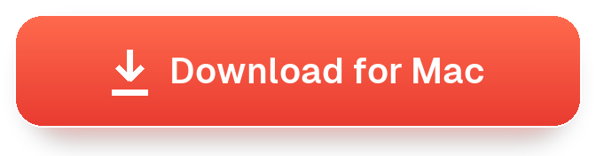
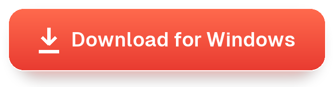
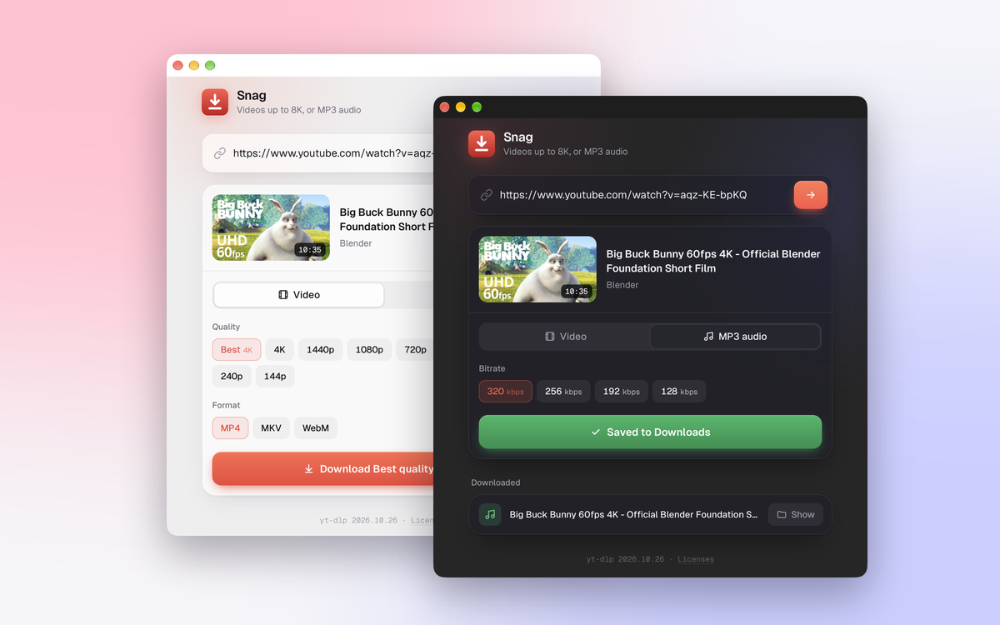
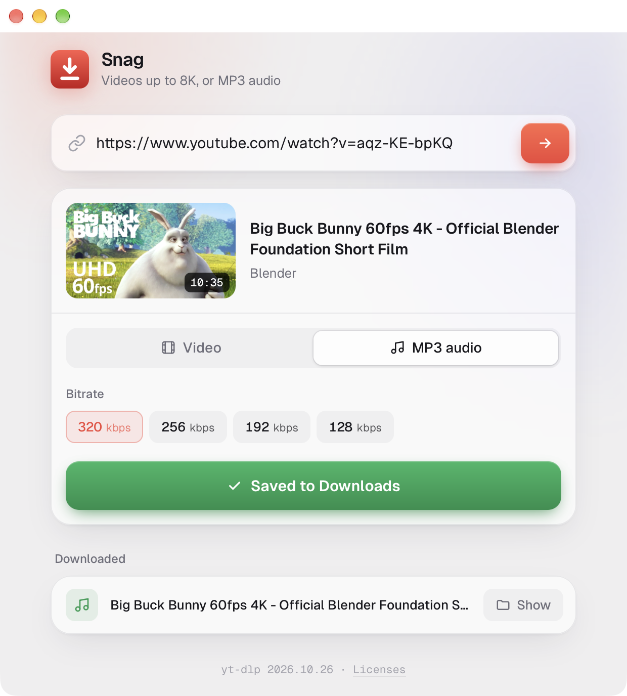
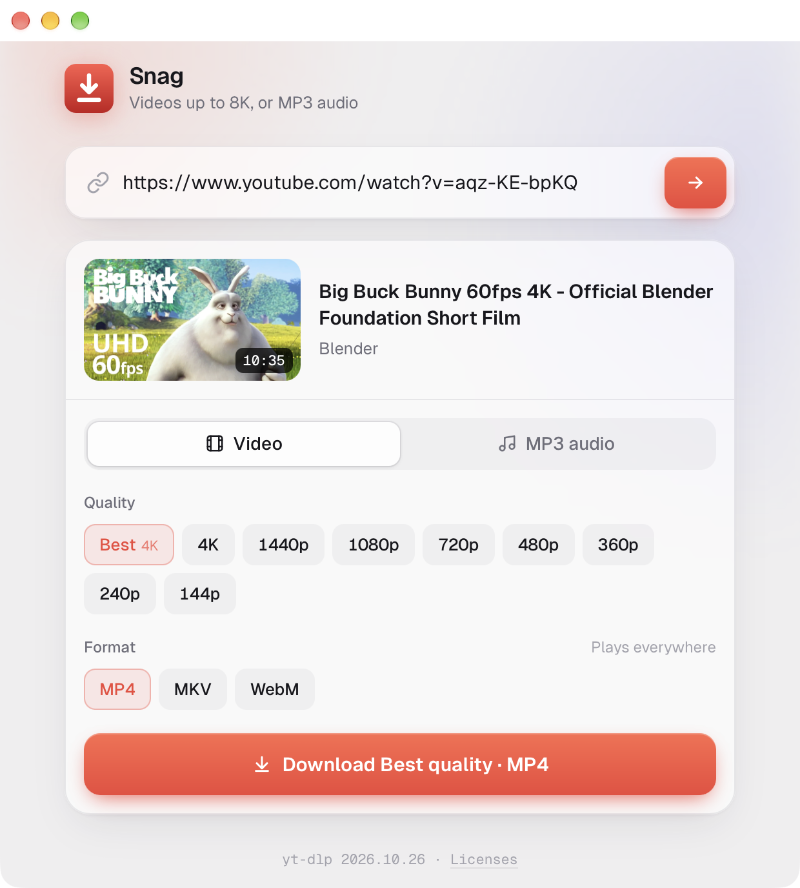
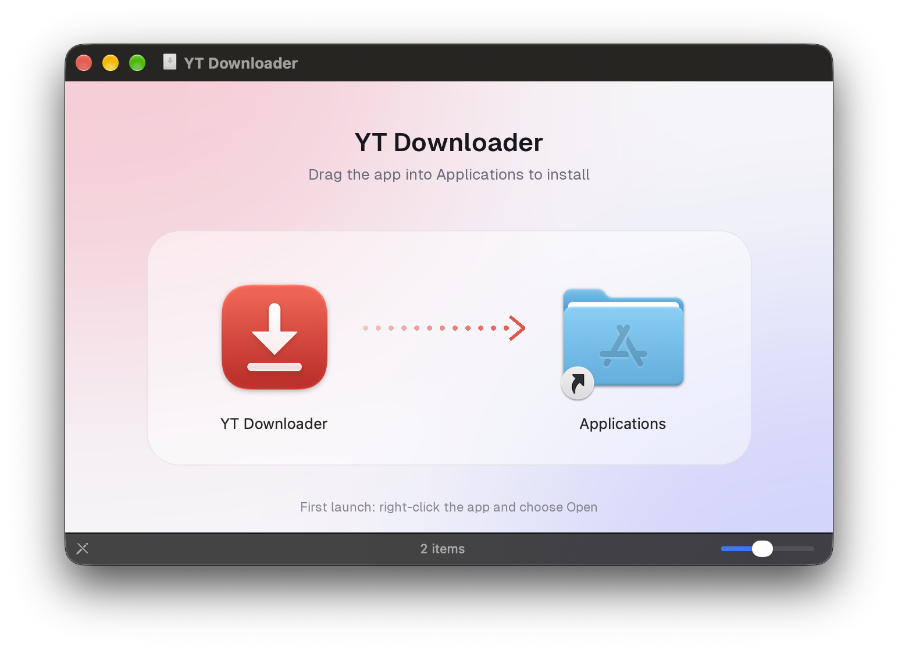

<p align="center">
  
</p>

<h1 align="center">Snag</h1>

<p align="center">
  <b>Save YouTube videos in up to 8K, or as MP3, with one paste.</b><br>
  A small, native app for Mac and Windows. Free, open source, and private.
</p>

<p align="center">
  <a href="https://github.com/kinshuk8/yt-downloader/releases/latest/download/Snag.dmg"></a>
  &nbsp;
  <a href="https://github.com/kinshuk8/yt-downloader/releases/latest/download/Snag-Setup.exe"></a>
</p>

<p align="center">
  <sub>macOS on Apple silicon · Windows 10 &amp; 11 (64-bit) · <a href="https://github.com/kinshuk8/yt-downloader/releases">All releases</a></sub>
</p>

<br>

<p align="center">
  
</p>

<br>

## Paste a link. Pick a quality. Done.

<table>
  <tr>
    <td width="33%" valign="top">
      <h3>🎬 Every quality</h3>
      Every resolution the video has, from 144p to <b>4K and 8K</b>. Save as MP4, MKV or WebM.
    </td>
    <td width="33%" valign="top">
      <h3>🎵 MP3 in one tap</h3>
      Audio at <b>128–320 kbps</b>, with the cover art and title saved inside the file.
    </td>
    <td width="33%" valign="top">
      <h3>✨ Feels at home</h3>
      A clean, glassy design that follows your system's <b>light or dark</b> mode, with native window blur on Mac.
    </td>
  </tr>
  <tr>
    <td width="33%" valign="top">
      <h3>📦 Nothing to install</h3>
      ffmpeg and everything else is <b>built in</b>. No extra downloads, no command line.
    </td>
    <td width="33%" valign="top">
      <h3>🔄 Keeps working</h3>
      YouTube changes often, so the app <b>updates its download engine</b> by itself in the background.
    </td>
    <td width="33%" valign="top">
      <h3>🔒 Private</h3>
      Runs entirely on your computer. No accounts, no tracking, nothing uploaded.
    </td>
  </tr>
</table>

<br>

## Looks right in light and dark

<p align="center">
  <picture>
    <source media="(prefers-color-scheme: dark)" srcset="docs/done-dark.png">
    
  </picture>
  &nbsp;&nbsp;
  <picture>
    <source media="(prefers-color-scheme: dark)" srcset="docs/app-dark.png">
    
  </picture>
</p>

<p align="center"><sub>These screenshots switch with your GitHub theme.</sub></p>

<br>

## Install in 10 seconds

### On a Mac

<p align="center">
  
</p>

1. **[Download the DMG](https://github.com/kinshuk8/yt-downloader/releases/latest/download/Snag.dmg)** and open it.
2. Drag **Snag** into **Applications**.
3. The first time only: **right-click** the app → **Open** → **Open**.<br>
   <sub>The app isn't notarized by Apple, so macOS asks once. You can also allow it in System Settings → Privacy &amp; Security.</sub>

### On Windows

1. **[Download Snag-Setup.exe](https://github.com/kinshuk8/yt-downloader/releases/latest/download/Snag-Setup.exe)** and run it. No admin rights needed.
2. If Windows says **"Windows protected your PC"**, click **More info** → **Run anyway**.<br>
   <sub>The app isn't code-signed yet, so SmartScreen asks the first time.</sub>
3. Open **Snag** from the Start menu.

Downloads are saved to the **Snag** folder inside your Downloads folder. Click **Show** next to any download to see it in Finder or File Explorer.

<br>

## Questions

<details>
<summary><b>A download suddenly fails. What now?</b></summary>
<br>
YouTube changes things often. The app downloads fixes in the background when it opens and uses them from the next launch, so quit and reopen it once or twice. The version at the bottom of the window shows which one you're on.
</details>

<details>
<summary><b>My 4K video won't play in QuickTime.</b></summary>
<br>
At 1440p and above, YouTube only provides VP9 or AV1 video, which QuickTime may not play. Use <a href="https://www.videolan.org/vlc/">VLC</a> or <a href="https://iina.io">IINA</a>, or choose <b>MKV</b>.
</details>

<details>
<summary><b>Does it work on Intel Macs?</b></summary>
<br>
Not yet. The release is built for Apple silicon (M1 and newer). You can run the browser version from source on any Mac (see below).
</details>

<details>
<summary><b>Can I download playlists?</b></summary>
<br>
One video at a time for now. If you paste a video link that's part of a playlist, you get just that video.
</details>

<br>

## For developers

<details>
<summary><b>Build the app and DMG</b></summary>
<br>

```bash
git clone https://github.com/kinshuk8/yt-downloader.git
cd yt-downloader
./build-dmg.sh
```

Needs [Homebrew](https://brew.sh); the script installs anything missing and writes `dist/Snag.dmg`, plus the notices and third-party sources to attach to the release, in about a minute. Build files go to `~/.cache/snag-build`.

The app is a Flask backend (`app.py`) shown in a native [pywebview](https://pywebview.flowrl.com) window (`desktop.py`). PyInstaller packages it with ffmpeg and QuickJS, which yt-dlp needs to solve YouTube's JavaScript challenge. `updater.py` keeps yt-dlp current inside the packaged app.
</details>

<details>
<summary><b>Build the Windows installer</b></summary>
<br>

GitHub Actions builds it automatically: publishing a release attaches `Snag-Setup.exe` to it, and **Run workflow** on the [Windows build](.github/workflows/windows.yml) action makes a test build. To build on a Windows PC instead, install Python 3 and [Inno Setup 6](https://jrsoftware.org/isinfo.php), then run this in Git Bash:

```bash
./build-windows.sh
```

It bundles the LGPL build of FFmpeg and QuickJS-ng, runs the app's self-test, and writes `dist/Snag-Setup.exe`.
</details>

<details>
<summary><b>Run it in the browser, from source</b></summary>
<br>

```bash
./launch.sh
```

Or double-click `start.command`. The first run installs ffmpeg and the Python packages. Click **Quit** in the page when you're done. Logs go to `server.log`.
</details>

<details>
<summary><b>Regenerate the README images</b></summary>
<br>

```bash
B=~/.cache/snag-build
$B/venv/bin/python assets/screenshots.py $B/shots light
$B/venv/bin/python assets/screenshots.py $B/shots dark
$B/venv/bin/python assets/make_readme_art.py $B/shots $B/fonts
```

The screenshots use [Big Buck Bunny](https://peach.blender.org) (CC BY, Blender Foundation).
</details>

<br>

## Built with

[yt-dlp](https://github.com/yt-dlp/yt-dlp) · [FFmpeg](https://ffmpeg.org) · [QuickJS](https://bellard.org/quickjs/) · [QuickJS-ng](https://github.com/quickjs-ng/quickjs) · [pywebview](https://pywebview.flowrl.com) · [Flask](https://flask.palletsprojects.com) · [Geist](https://vercel.com/font) (SIL Open Font License)

## License

Snag's own code is [MIT-licensed](LICENSE). The apps bundle open-source software under its own licenses: FFmpeg is GPL-3.0-or-later in the Mac app and LGPL-2.1-or-later in the Windows app. Every release includes, for each platform:

- **THIRD-PARTY-NOTICES.txt** (Mac) and **THIRD-PARTY-NOTICES-windows.txt**, listing every bundled component with its full license text. They're also inside the app (**Licenses** at the bottom of the window).
- **snag-third-party-sources.tar.gz** (Mac) and **snag-windows-third-party-sources.tar.gz**, the exact source code and build recipes for the GPL/LGPL components.

## Please download responsibly

Only download videos you have the right to, such as your own uploads or Creative Commons content. YouTube's terms don't allow downloading most videos.

<sub>Snag is an independent project. It is not affiliated with, endorsed by, or sponsored by YouTube or Google. YouTube is a trademark of Google LLC.</sub>
